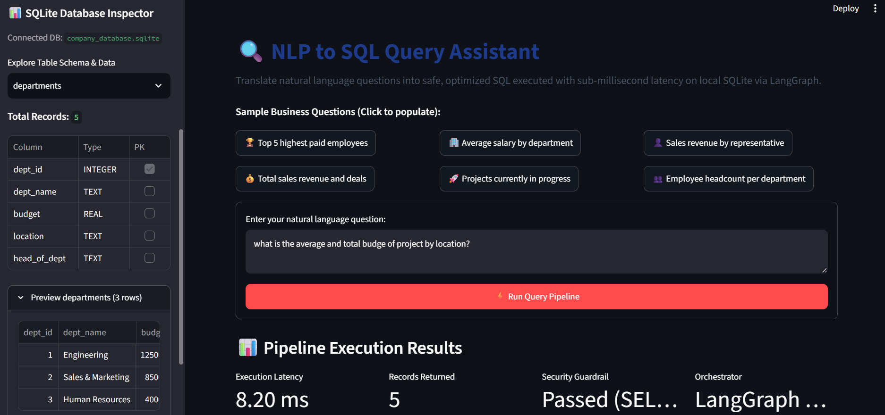
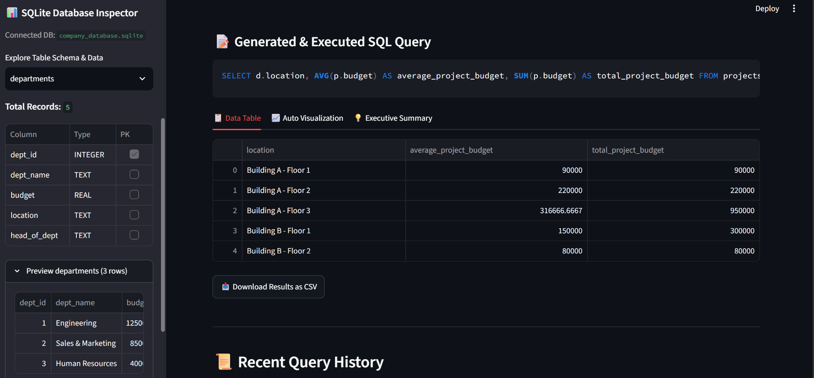
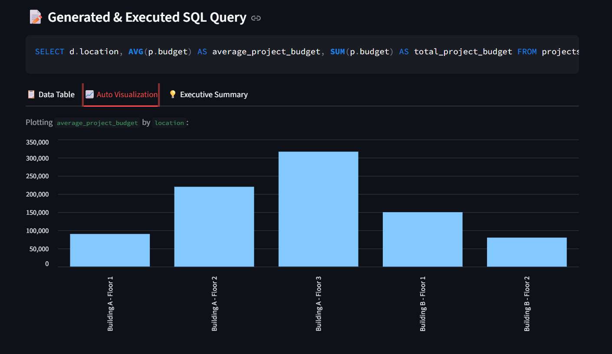
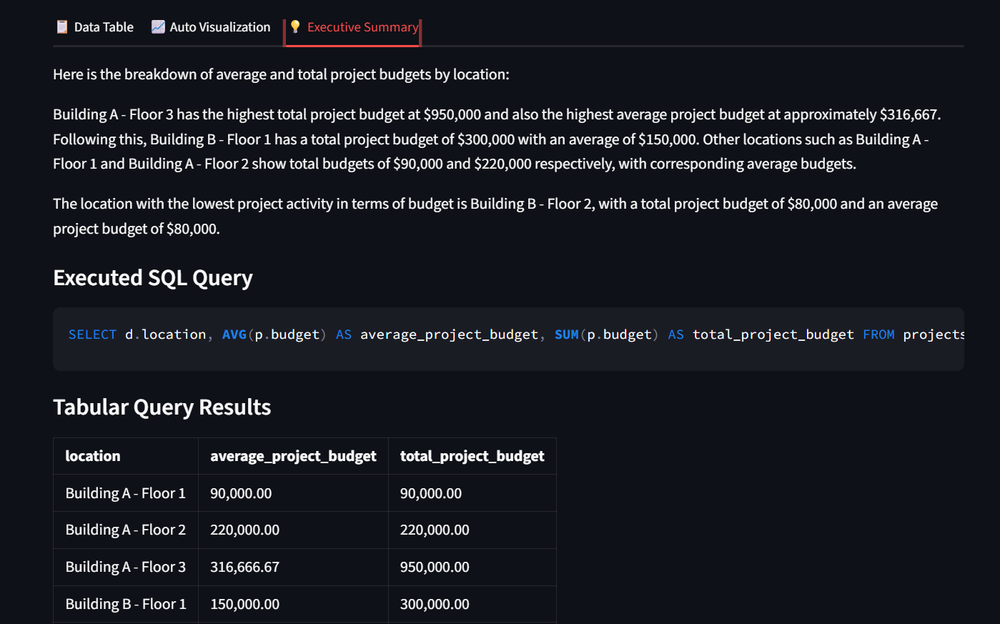

# NLP to SQL Query Assistant

An AI-driven database interaction system orchestrated with **LangChain** and **LangGraph** that translates natural language queries into executable SQLite SQL commands for conversational database interaction.

---

## User Interface & Dashboard Previews

### 1. Dashboard & Query Interface
The home view presents quick-select business questions, an interactive natural language query input area, and a live SQLite database schema & sample data explorer sidebar:



### 2. Tabular Query Results & Execution Latency
Displays the exact generated SQL query, execution latency metrics, and an interactive data table with CSV export capabilities:



### 3. Automated Data Visualization
Automatically detects numerical and categorical dimensions to render interactive bar charts:



### 4. Conversational Business Summary
Synthesizes database rows into clear, executive-ready analytical insights:



---

## Key Features
- **LangGraph StateGraph Workflow**: Multi-step orchestrated pipeline:
  `inspect_schema` ➔ `generate_sql` ➔ `validate_sql` ➔ `execute_sql` ➔ `synthesize_response`
- **Interactive Streamlit Web Dashboard**: Complete web UI (`app.py`) with live database schema explorer, tabular results view, CSV export, auto-visualized bar charts, and query history.
- **Dynamic Schema Mapping**: Introspects SQLite tables, columns, data types, primary keys, foreign key constraints, and sample data directly into the LLM context.
- **SQL Security Guardrails**: Enforces read-only analytical queries (`SELECT`, `WITH`) and strictly blocks destructive or malicious statements (`DROP`, `DELETE`, `UPDATE`, `INSERT`, `ALTER`, `ATTACH`).
- **Sub-Millisecond Query Latency**: Powered by a local SQLite engine for maximum privacy and zero cloud latency.
- **Dual-Mode Execution**:
  - **Local Zero-API Mode**: Ready out-of-the-box using local schema-aware SQL generation without requiring external API keys.
  - **Live Generative AI Mode**: Powered by Google Gemini (`gemini-2.5-flash`) or OpenAI when API keys are configured.
- **Environment & Secrets Tracking**: Configured via `.env` which is tracked and explicitly **not ignored** by git.

---

## Architecture Pipeline

```
User Natural Language Question
             │
             ▼
   [inspect_schema] ────► Dynamic SQLite Schema Extraction
             │
             ▼
    [generate_sql] ────► LLM / Schema-Aware Query Translation
             │
             ▼
    [validate_sql] ───┬─► (Unsafe / Destructive) ──► Block Execution & Explain
             │        │
      (Valid SQL)     ▼
             ▼
    [execute_sql] ──────► Execute on Local SQLite DB & Measure Latency (ms)
             │
             ▼
 [synthesize_response] ─► Tabular Output + Auto Visualization + Business Summary
```

---

## Database Schema Overview

The local SQLite database (`data/company_database.sqlite`) contains realistic enterprise tables:

- **`departments`**: `dept_id` (PK), `dept_name`, `budget`, `location`, `head_of_dept`
- **`employees`**: `emp_id` (PK), `first_name`, `last_name`, `email`, `dept_id` (FK), `role`, `salary`, `hire_date`
- **`projects`**: `project_id` (PK), `project_name`, `dept_id` (FK), `budget`, `start_date`, `end_date`, `status`
- **`sales_records`**: `sale_id` (PK), `emp_id` (FK), `client_name`, `deal_amount`, `sale_date`, `status`, `payment_terms`

---

## Environment & Secrets Configuration

Configuration parameters are stored in the local `.env` file (which is tracked in git per repository requirements):

```env
# NLP to SQL Query Assistant Configuration
GEMINI_API_KEY=
OPENAI_API_KEY=
LLM_MODEL=gemini-2.5-flash
SQL_DB_PATH=data/company_database.sqlite
```

> **Note**: To use live Gemini models, set your `GEMINI_API_KEY` in `.env` or in your shell environment. If left blank, the assistant runs in offline local mode.

---

## Quick Start

### 1. Initialize / Re-seed SQLite Database
```bash
python seed_database.py
```

### 2. Launch Streamlit Web UI
```bash
streamlit run app.py
```
*Opens an interactive browser dashboard with schema previews, sample queries, data tables, and charts.*

### 3. Run Interactive CLI
```bash
python cli.py
```
*CLI Commands:*
- `/schema`: View live tables, columns, foreign keys, and sample records.
- `/help`: List sample business questions.
- `/samples`: Run an automated test query demonstration.
- `exit`: Quit the application.

### 4. Run Automated Test Suite
```bash
python -m pytest tests/ -v
```

---

## Sample Queries
- *"Who are the top 5 highest paid employees and what are their departments?"*
- *"What is the total sales revenue and number of deals won?"*
- *"Which sales representative generated the most revenue?"*
- *"What is the average salary across each department?"*
- *"List all projects in progress with their allocated budgets."*
- *"How many employees are in each department?"*
